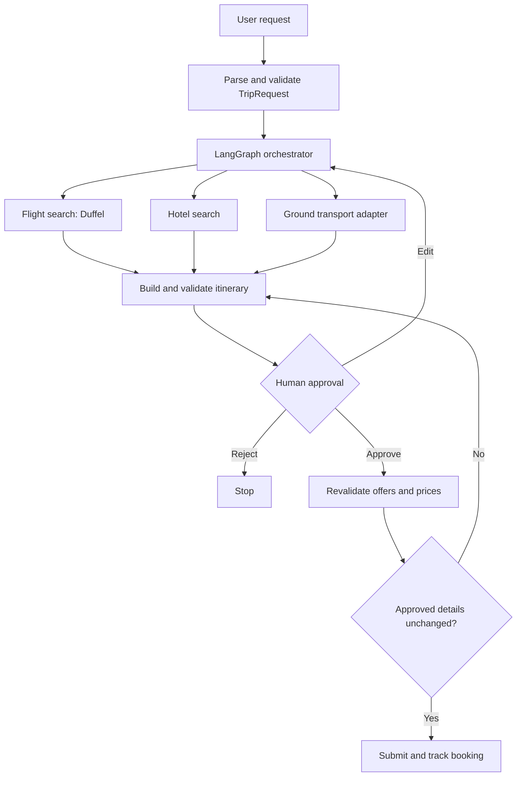

# TripMate AI

**An agentic travel planner designed to search flights, hotels, and ground transport, assemble a constraint-checked itinerary, and book only after explicit user approval.**

> 🚧 **Status: early development.** Flight search is the initial implementation focus. Full itinerary planning and approval-based booking are planned. Roadmap items will be checked after the corresponding code is added and verified.

## Why TripMate?

Most AI travel demos stop at “here are some flights.” A useful travel planner also needs to handle changing prices, expired offers, uncertain booking outcomes, and travel schedules that must fit together.

TripMate is designed around those problems, with structured requests, itinerary validation, and explicit approval before booking.

## Planned architecture

The design uses a single orchestrator with typed tools for parsing, search, validation, and booking. Explicit workflow steps make decisions and failures easier to trace and test.

Persistent checkpoints and an approval pause are planned for the booking phase.

## Key design decisions

### Human approval gate

The system will be able to search and propose options automatically. Before booking, it will show the selected itinerary, passenger details, and total price for explicit approval.

Changes to approved booking details will require renewed approval.

### Re-pricing before booking

Selected offers will be revalidated before checkout. If price, availability, or itinerary details change, the system will return to the user for review.

### Booking reliability

A timeout does not necessarily mean that a booking failed.

Each booking attempt will be recorded before contacting the provider. Unknown outcomes will be reconciled with provider records before retrying. Provider-supported idempotency will be used where available; unresolved attempts will require review.

A locally stored key alone does not guarantee that a supplier will prevent duplicate orders.

### Itinerary constraints

Planned checks include:

- Consistent dates across flights and hotel stays.
- Sufficient time for transfers and connections.
- Hotel arrival compatibility with check-in policies.
- Time-zone differences and overnight journeys.
- Budget limits and clearly labeled estimated costs.

Unavailable supplier information will be flagged rather than treated as verified.

### Pluggable ground transport

Ground transport will sit behind a `GroundTransport` interface. The initial adapter will use mock results and links to external services.

Direct booking will depend on supplier access and supported APIs.

## Technology plan

| Layer | Technology | Role |
| --- | --- | --- |
| Language | Python 3.11+ | Application logic |
| LLM | Claude API | Natural-language request extraction |
| Orchestration | LangGraph | Workflow routing and state |
| Schemas | Pydantic | Request and response validation |
| Flights | Duffel | Flight search and test-mode booking |
| CLI | Rich | Terminal prompts and results |
| Hotels | Duffel Stays, subject to verification | Planned hotel integration |
| API | FastAPI | Planned application endpoints |
| Storage | PostgreSQL | Planned booking records and checkpoints |
| Testing | pytest | Unit, integration, and failure-scenario tests |

Development will use Duffel test mode. Supported flight, hotel, booking, and payment flows will be verified separately during implementation.

## Roadmap

### Phase 1: Flight search

- [ ] Parse natural-language requests into a typed `TripRequest`.
- [ ] Ask for missing required information.
- [ ] Search flights through Duffel.
- [ ] Rank options by price, duration, and stops.
- [ ] Display results in a CLI.
- [ ] Verify parser, ranking, and graph tests.

### Phase 2: Approval and booking

- [ ] Persist workflow state.
- [ ] Add an approval gate using LangGraph interrupts.
- [ ] Revalidate selected offers before booking.
- [ ] Record booking attempts before provider calls.
- [ ] Reconcile uncertain outcomes before retrying.
- [ ] Test rejection, expired offers, price changes, and timeouts.

### Phase 3: Full itinerary

- [ ] Add hotel search.
- [ ] Add a ground transport adapter with mock results and external links.
- [ ] Validate flights, hotels, transfers, and time zones together.
- [ ] Present a combined itinerary and cost breakdown.
- [ ] Handle partial booking failures across suppliers.

### Phase 4: Reliability

- [ ] Create 30–50 evaluation requests with expected outcomes.
- [ ] Add failure-injection tests.
- [ ] Track task success, tool errors, latency, and token cost.
- [ ] Run automated tests through GitHub Actions.

## Evaluation plan

The evaluation set will include complete requests, missing information, unavailable flights, connecting journeys, expired offers, price changes, and uncertain booking outcomes.

Tests will check whether the system asks appropriate follow-up questions, ranks options correctly, respects approval decisions, and handles failures without blindly repeating booking requests.

Evaluation results will be published after the suite is implemented and run.

## Getting started

Setup instructions will be finalized after the initial source code and dependencies are uploaded and verified.

The intended prerequisites are:

- Python 3.11 or later.
- A Duffel test-mode access token.
- An Anthropic API key.

Credentials will be loaded from a local `.env` file. The repository will include an `.env.example` containing placeholders.

## Intended project layout

- `tripmate/schemas.py` — Typed travel requests and flight results.
- `tripmate/parser.py` — Request extraction and validation.
- `tripmate/duffel.py` — Duffel flight-search integration.
- `tripmate/ranking.py` — Scoring by price, duration, and stops.
- `tripmate/graph.py` — Parse, search, and rank workflow.
- `tripmate/cli.py` — Terminal interface.
- `tests/` — Unit and workflow tests using fake responses.

## License

MIT. See [LICENSE](LICENSE).
